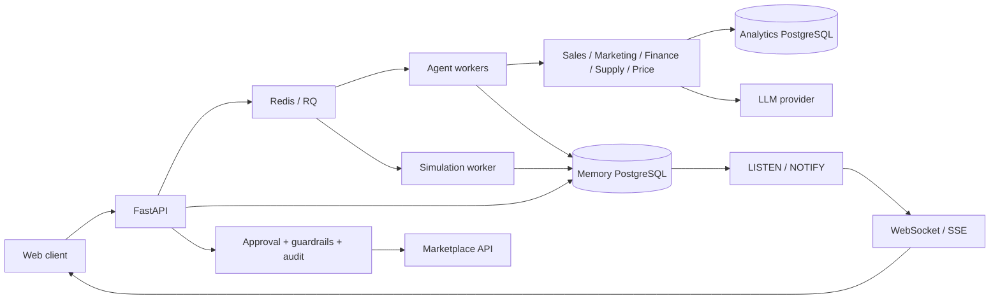

# E-commerce AI Backend

**Python backend для аналитики маркетплейсов и принятия решений на основе данных.** FastAPI принимает бизнес-вопрос, профильные агенты получают факты из PostgreSQL, а отдельный слой рассчитывает эффект и проверяет предлагаемые действия.

Проект демонстрирует backend-разработку вокруг AI: API, фоновые задачи, хранение состояния, финансовые расчёты, согласование действий, восстановление после сбоев и наблюдаемость.

**Stack:** Python 3.11 · FastAPI · PostgreSQL · Redis/RQ · OpenAI Agents SDK · NumPy · Docker · Prometheus · Langfuse.

## Бизнес-задача

Продавцу маркетплейса нужно понимать, почему изменились продажи, где заканчивается запас, какие рекламные кампании неэффективны и допустимо ли менять цену. Для ответа недостаточно одного SQL-запроса: нужно согласовать продажи, рекламу, остатки, себестоимость и финансовые ограничения.

Backend объединяет эти источники в диагностический workflow и сохраняет выводы, происхождение фактов и пробелы данных. Изменения цен и рекламы проходят отдельный процесс согласования.

| Компонент | Что реализовано |
| --- | --- |
| REST API и WebSocket | Чат, история, статусы агентских запусков, отчёты и потоковые обновления |
| Пять доменных агентов | Продажи, маркетинг, финансы, поставки и цены |
| Фоновые задачи | Очереди RQ, workers и восстановление зависших запусков |
| Аналитика | SQL-витрины, детерминированные расчёты, проверка доказательств и явные gaps |
| Action Board | Хранение предложенных действий, статусов и результатов |
| Manager Decision | Авторизация, роли, approval, idempotency, guardrails и аудит исполнения |
| Симуляции | NumPy bootstrap-сценарии, seeds, snapshots, ranking и replayable events |
| Наблюдаемость | Prometheus, Langfuse, журналы событий и трассировка |

## Архитектура



Аналитическая БД — внешний источник данных. Memory PostgreSQL хранит чаты, запуски, решения и события. Redis доставляет задания; долговременное состояние хранится в PostgreSQL.

Загрузка данных вынесена в отдельный проект: [ETL-WB-portfolio](https://github.com/semenovjenya/ETL-WB-portfolio). Для совместного запуска нужно согласовать схемы и подключения; готового общего Compose в этой версии нет.

## Что посмотреть в коде

| Инженерная задача | Точка входа |
| --- | --- |
| API и асинхронный приём запросов | [`api.py`](agi_ecom_app/api.py), [`agent_queue.py`](agi_ecom_app/agent_queue.py) |
| Доменные агенты и оркестрация | [`main_agent.py`](agi_ecom_app/main_agent.py), [`runner.py`](agi_ecom_app/runner.py) |
| Хранение и работа с PostgreSQL | [`services/`](agi_ecom_app/services/), [`docker/postgresmemory/`](docker/postgresmemory/) |
| Расчёт сценариев и проверка выводов | [`forecast/`](agi_ecom_app/forecast/) |
| Согласование и исполнение действий | [`manager_lifecycle/`](agi_ecom_app/manager_lifecycle/) |
| Воспроизводимые симуляции | [`decision_simulation/`](agi_ecom_app/decision_simulation/) |
| Доставка обновлений клиенту | [`agent_run_notifications.py`](agi_ecom_app/agent_run_notifications.py) |
| Автоматические проверки | [`tests/`](tests/) |

Численные бизнес-расчёты отделены от LLM. Отсутствующие данные должны оставаться пробелом данных, а не превращаться в ноль. Наличие токена WB не разрешает запись само по себе: для внешних действий предусмотрены отдельные flags, approval и проверки.

## Локальная проверка без ключей

```bash
git clone https://github.com/semenovjenya/ecommerce-ai-backend.git
cd ecommerce-ai-backend
python3.11 -m venv .venv
source .venv/bin/activate
python -m pip install -r requirements.lock.txt
python -m pytest -q
```

`requirements.lock.txt` фиксирует версии окружения, использованного при проверке портфолио. Исходные диапазоны зависимостей сохранены в `requirements.txt`.

Тесты используют подмены внешних сервисов. Проверка unit-тестов не означает, что полный workflow проверен с реальным WB-кабинетом. Результаты и границы проверки описаны в [отчёте подготовки](docs/portfolio-verification.md).

## Запуск API с собственными данными

```bash
cp .env.example .env
# Заполните OPENAI_API_KEY и ANALYTICS_POSTGRES_*.
docker compose up --build
```

- Swagger UI: `http://localhost:8000/docs`
- API health: `http://localhost:8000/health`
- Чат: `/v1/chat/sessions`, `/v1/chat/messages`, `/v1/chat/ws`
- Статус анализа: `/v1/chat/agent-runs/{run_id}/status`
- Решения и симуляции: `/v1/manager/*`

Compose запускает API, фоновые workers, Redis и memory PostgreSQL. Аналитическую БД с данными нужно подключить отдельно. Для импорта документов требуется настроенный внешний Airflow.

**Это локальный development runtime.** У части legacy-маршрутов отсутствует единая авторизация. Не открывайте API в интернет без gateway/authentication и проверки доступа к данным. Опубликованные пароли локальных контейнеров — демонстрационные значения. Запись в WB по умолчанию отключена.

Подробнее: [конфигурация, API и runtime](docs/runtime-guide.md).

## Структура

```text
agi_ecom_app/
  api.py                    # FastAPI
  runner.py                 # Оркестрация агентов
  agent_queue.py            # Очередь запусков
  services/                 # БД и интеграции
  forecast/                 # Расчёты, сценарии, critic
  manager_decision/         # Формирование портфеля действий
  manager_lifecycle/        # Approval, execution, measurement
  decision_simulation/      # Bootstrap engine и события
  sku_previews/             # Карточки товаров
  document_import/          # Себестоимость и документы
  action_board/             # Actions и manager API
  unit_economics/            # Юнит-экономика
  commission_calculator/    # Комиссии
  prompts/                  # Промпты и каталоги источников
services/commerce-agent/    # Экспериментальная миграция на LangGraph
sql/                       # SQL-витрины
tests/                     # Unit и regression tests
docker/                    # Схема memory PostgreSQL
```

## Статус и ограничения

- Портфолио экспортировано из сохранённой версии исходного проекта; незакоммиченная рабочая миграция сюда не перенесена.
- Основной runtime использует OpenAI Agents SDK и RQ. `services/commerce-agent` показывает работу над LangGraph; это отдельный экспериментальный сервис с собственными зависимостями, не завершённая замена основного runtime.
- Исторические документы миграции могут ссылаться на приватные evidence-артефакты, исключённые из публичной версии. Их утверждения не являются результатами проверки этого экспорта.
- Реальные секреты, история исходного Git, резюме, локальные отчёты и приватные evidence-выгрузки исключены. Финансовые примеры в regression fixtures заменены демонстрационными значениями.
- Нет подтверждённых показателей экономического эффекта, SLA или качества на независимом датасете. Bootstrap-ranking не доказывает причинный эффект изменения цены или рекламы.
- Следующие инженерные шаги: единая авторизация legacy API, интеграционное окружение с синтетической аналитической БД, завершение миграции и сокращение крупных модулей оркестрации.
