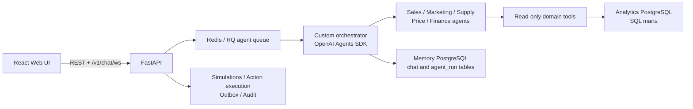
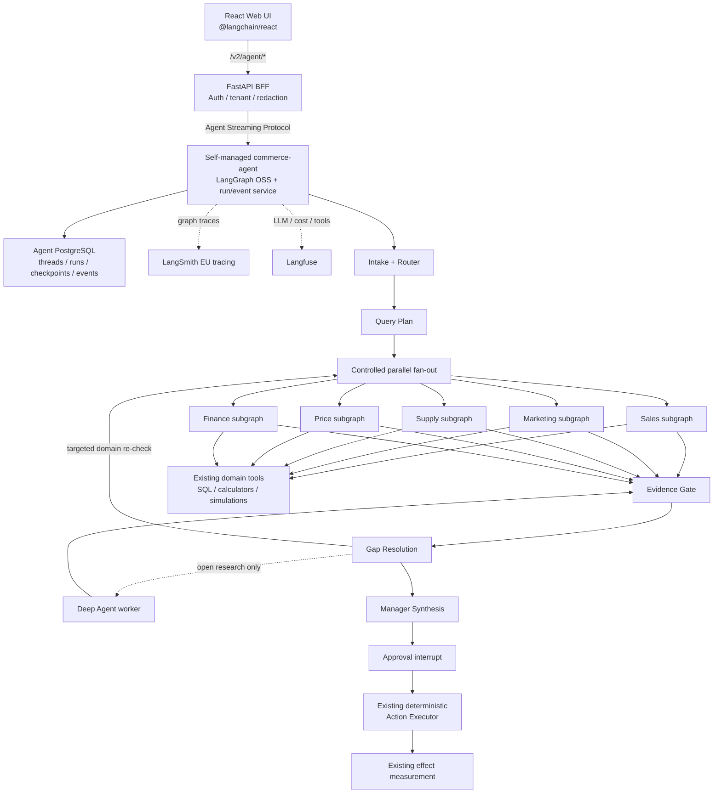

# Переход AI-ECOM на LangGraph-стек

Статус: целевая архитектура и implementation-ready план миграции.

Этот комплект документов фиксирует окончательное разделение ответственности между AI-runtime, интерфейсом, автономными исследовательскими агентами и существующим бизнес-ядром AI-ECOM. Он является единым источником решений для перехода; дочерние документы уточняют реализацию своих слоёв, но не изменяют общие контракты и критерии готовности из этого README.

## Архитектурное решение

- **LangGraph OSS в отдельном self-managed `commerce-agent` service** становится основным runtime для новых agent runs, interrupts и graph streaming; durable threads и checkpoints хранятся в отдельной PostgreSQL database.
- **LangSmith EU tracing + Langfuse** работают параллельно как независимые fail-open observability-контуры. Они не являются runtime, checkpoint store или источником бизнесового state.
- **LangChain Frontend SDK** становится единственным realtime-контрактом нового Web UI с agent runtime.
- **Deep Agents** используются только как ограниченные research workers для открытых, длинных и заранее не определённых исследований. Их реализация (`M5`) не блокирует первый production cutover: до отдельного acceptance нода `deep_research` остаётся выключенной и не получает tools.
- **FastAPI, PostgreSQL/SQL marts, детерминированные расчёты, симуляции, outbox, audit и action execution** остаются бизнес-ядром и источником истины.
- **OpenAI Agents SDK** удаляется из активного runtime после достижения функционального и качественного parity. OpenAI может оставаться model provider через LangChain.
- Переключение production выполняется как **big-bang cutover после полного staging acceptance**, без длительного dual-runtime и без двусторонней синхронизации истории.

## Как читать комплект

1. [LangGraph runtime](langgraph/README.md) — граф, состояние, PostgreSQL checkpoints и self-managed deployment.
2. [LangChain Frontend SDK](langchain-frontend-sdk/README.md) — новый UI/runtime-контракт и замена собственного WebSocket.
3. [Deep Agents](deep-agents/README.md) — допустимая зона автономных исследований и ограничения.
4. [Существующая платформа](existing-platform/README.md) — что сохраняется, адаптируется и выводится из эксплуатации.
5. [Статус миграции](MIGRATION_STATUS.md) — slices, зависимости, acceptance gates, evidence и rollback ledger.

## Текущая архитектура



Текущий контур уже содержит доменные output-контракты, evidence policy, раунды, gaps, action safety, durable бизнесовые записи и проверенные вычислительные сервисы. Миграция заменяет orchestration/runtime и транспорт, а не переписывает бизнесовую математику.

## Целевая архитектура



Публичный путь нового agent runtime:

```text
Web UI -> FastAPI /v2/agent/* -> self-managed commerce-agent API -> commerce_agent
```

FastAPI проксирует зафиксированный контракт Agent Streaming Protocol, привязывает `tenant_id` и `user_id`, применяет rate limits и redaction и не раскрывает provider credentials браузеру. `commerce-agent` владеет durable run lifecycle и event replay, а отдельная PostgreSQL database — threads, runs, checkpoints и журнал событий. Сам по себе LangGraph checkpointer сохраняет состояние графа, но не реализует API команд, межпроцессный stream/rejoin или восстановление run worker: это отдельная ответственность self-managed service. Бизнесовые API остаются отдельными от agent protocol.

Sales, Marketing, Supply, Price и Finance не исчезают при переходе: они становятся фиксированными LangGraph subgraphs. Петля `gap_resolution -> controlled fan-out` повторно запускает только нужные доменные проверки; Deep Agent подключается отдельно и не заменяет доменные роли.

В первом production-релизе граф обязан корректно завершать workflow без Deep Agent: unresolved research gap становится явным limitation/`needs_data`, а не неявным вызовом исследовательского worker. Включение `M5` — отдельный последующий release gate, не часть `M8` acceptance основного графа.

## Матрица ответственности

| Область | Владелец | Не должен делать |
| --- | --- | --- |
| Порядок нод, ветвление, retry, checkpoint, interrupt | LangGraph | Считать бизнесовые метрики или напрямую менять WB |
| Threads, runs, checkpoints, durable event replay и streaming | `commerce-agent` + agent PostgreSQL | Становиться источником истины для финансовых и операционных фактов |
| Graph traces и LangGraph debugging | LangSmith EU tracing | Хранить authoritative checkpoint state или быть условием выполнения run |
| LLM/tool telemetry, cost и dashboards | Langfuse | Управлять graph routing, resume или actions |
| Realtime UI и управление run | Frontend SDK | Хранить provider/runtime secrets или самостоятельно восстанавливать graph state |
| Открытое исследование и динамическая декомпозиция | Deep Agents | Принимать финальное решение или получать write-tools |
| Auth, tenant boundary, proxy и business API | FastAPI | Дублировать graph orchestration |
| Метрики и подготовленные факты | SQL marts и calculators | Передавать вычисление формул свободному LLM |
| Scenario evaluation | Simulation services | Зависеть от ephemeral graph state как от единственного хранилища |
| Внешние изменения | Action execution + outbox + audit | Выполнять side effect без approval, idempotency и verification |

## Единый контракт `CommerceState`

Ниже приведён логический публичный контракт. Конкретная реализация может использовать `TypedDict`, Pydantic-модели и reducers, но имена верхнеуровневых полей являются стабильными для graph, BFF и frontend.

```python
class CommerceState(TypedDict):
    schema_version: int
    messages: Annotated[list[BaseMessage], add_messages]

    tenant_id: str
    user_id: str
    request_id: str
    query_plan: QueryPlan | None

    agent_statuses: dict[str, AgentStatus]
    sales_analysis: SalesAnalysis | None
    marketing_analysis: MarketingAnalysis | None
    supply_analysis: SupplyAnalysis | None
    price_analysis: PriceAnalysis | None
    finance_analysis: FinanceAnalysis | None
    research_result: ResearchResult | None

    detected_incidents: list[Incident]
    evidence_matrix: list[EvidenceItem]
    data_gaps: list[DataGap]
    action_tasks: list[ActionTask]
    confidence: ConfidenceReport | None
    manager_decision: ManagerDecision | None

    pending_interrupt: ApprovalRequest | None
    execution_receipts: list[ActionReceipt]
    errors: list[WorkflowError]
```

Обязательные инварианты:

- `schema_version` меняется при несовместимом изменении сохранённого state.
- `tenant_id`, `user_id` и `request_id` неизменяемы в пределах run; авторизация проверяется сервером, а не доверяется входному state из браузера.
- `agent_statuses` содержит фиксированные ключи `sales`, `marketing`, `supply`, `price`, `finance` и опциональный `deep_research`.
- Domain results пишутся только соответствующими subgraphs; параллельные ветки не перезаписывают чужие поля.
- `evidence_matrix`, `data_gaps`, `action_tasks`, `execution_receipts` и `errors` используют append/deduplicate reducers с устойчивым ID.
- `manager_decision` создаётся только после `evidence_gate` и `gap_resolution`.
- `pending_interrupt` обязателен перед любой внешней write-операцией.
- Secrets, provider keys, auth tokens, cookies и DSN никогда не сохраняются в state, messages, tool results или checkpoints.

## Сквозной поток данных

1. BFF аутентифицирует пользователя и создаёт либо открывает thread в self-managed `commerce-agent`; state сохраняется в agent PostgreSQL.
2. `intake` нормализует запрос, `router` определяет intent, `query_plan` формирует типизированный план.
3. Graph запускает только необходимые фиксированные domain subgraphs с контролируемой параллельностью.
4. Каждый subgraph вызывает адаптированные read-only tools и возвращает типизированный domain result.
5. `evidence_gate` отделяет доказанные факты от гипотез и создаёт `data_gaps`.
6. `gap_resolution` выполняет ограниченные повторные проверки. Deep Agent вызывается только если gap соответствует разрешённому research policy.
7. `synthesis` формирует incidents, actions, confidence и manager decision.
8. Для внешнего действия graph создаёт interrupt; пользователь approve/edit/reject продолжает тот же thread и checkpoint.
9. Детерминированный action service выполняет операцию через idempotency/outbox/audit и возвращает receipt.
10. Effect measurement остаётся отдельным бизнесовым процессом и записывает фактический результат в локальную БД.

## Этапы перехода и big-bang cutover

Разработка выполняется последовательно, но production traffic переключается один раз.

1. **Baseline (`M0`):** зафиксировать или принять с явным waiver reference текущего runtime для latency, cost, terminal success, evidence/guardrails и детерминированных результатов.
2. **Graph skeleton (`M1`):** подготовить `commerce_agent`, state schemas, PostgreSQL checkpoints и self-managed package. До подключения реальных данных закрыть ingress/checkpoint/trace secret-canary gate; проверка только внутри graph node не защищает первый trace event.
3. **Сквозная проверка протокола (`M1.5`):** до переноса domain tools/agents доказать на stub graph тонкий путь `@langchain/react` v1 → authenticated `/v2/agent/*` → self-managed `commerce-agent` → PostgreSQL. Проверить start/stream, checkpoint, interrupt/resume, разрыв и replay после перезапуска процесса и на другом worker, а также tenant isolation. Зафиксировать точные версии SDK и wire contract; при провале пересмотреть transport/runtime решение до `M2`, не переносить бизнес-агентов вслепую. Это development/staging spike без production traffic и без второго долгоживущего runtime.
4. **Business graph (`M2–M4`):** адаптировать read-only tools, перенести пять фиксированных subgraphs, evidence/gap/synthesis, approvals и безопасный action path с parity и failure tests на каждом slice.
5. **Research (независимый `M5`):** после `M4` при необходимости подключить Deep Agent за policy gate. Первый cutover допустим без `M5`, если disabled path проверен в staging.
6. **Production BFF и UI (`M6–M7`):** расширить проверенный в `M1.5` тонкий путь до полного auth, history, structured UI, reconnect и эксплуатационных проверок; старый production UI работает до cutover, compatibility между протоколами не создаётся.
7. **Acceptance (`M8`):** прогнать regression corpus, failure injection, auth/tenant isolation, security/redaction, load и cost tests; проверить, что выключенный `deep_research` не вызывает tools и не блокирует основной workflow.
8. **Cutover (`M9`):** остановить приём новых сообщений через legacy POST/WS, задеплоить новый BFF/UI, направить новые диалоги в `commerce_agent`; legacy GET/history остаются read-only.
9. **Observation и retirement (`M9–M10`):** усиленный мониторинг 72 часа, затем удалить OpenAI Agents SDK, agent RQ execution path и старый WebSocket из активного пути. Legacy chat/run data остаются read-only согласно retention policy.

## Rollback

- До cutover сохранить версии backend, worker и Web UI images, применённые конфигурации и резервную копию memory PostgreSQL.
- Rollback возвращает предыдущие images и routing. Новые agent PostgreSQL threads не импортируются в legacy runtime и сохраняются read-only для аудита.
- Любые actions, успевшие выполниться после cutover, не откатываются повторным вызовом старого runtime: их фактическое состояние восстанавливается из локальных receipts, outbox и read-after-write verification.
- Перед production cutover провести минимум одну полную rollback rehearsal в staging.

## Глобальный Definition of Done

Переход считается завершённым только при одновременном выполнении всех условий:

- 100% новых диалогов создают durable thread и run `commerce_agent` через `/v2/agent/*` в self-managed runtime.
- Page reload, временная потеря сети и перезапуск worker не теряют run; выполнение продолжается от сохранённого checkpoint, а stream восстанавливает непропущенные события из durable журнала по sequence ID, в том числе на другом worker.
- До переноса domain agents (`M2–M3`) выполнен `M1.5`: закреплён совместимый `@langchain/react` v1 transport, подтверждены команды, stream/replay, state/history и tenant-safe rejoin через BFF.
- UI в реальном времени показывает фиксированные domain agents, текущую ноду, tool lifecycle, gaps, structured outputs и interrupts.
- Approve/edit/reject продолжает тот же thread и не создаёт повторный side effect.
- OpenAI Agents SDK, custom agent orchestration, agent RQ queue и `/v1/chat/ws` отсутствуют в активном production path.
- SQL marts, calculators, simulations, action execution, outbox и audit сохраняют текущие бизнесовые контракты и результаты.
- Все write-операции требуют interrupt, idempotency key, audit record и read-after-write verification.
- Evidence/guardrail regression corpus проходит без ухудшения принятого baseline; критические нарушения равны нулю.
- p95 end-to-end latency не превышает baseline более чем на 20%, средняя LLM-стоимость run не превышает baseline более чем на 15%, terminal success rate не ниже baseline.
- Tenant isolation, redaction и отсутствие secrets в PostgreSQL checkpoints, LangSmith traces и Langfuse observations подтверждены автоматическими тестами и canary-проверками.
- Первый cutover проходит с выключенным `deep_research`; отсутствие `M5` не нарушает фиксированные domain workflows, а его последующее включение требует собственного acceptance.
- Production rollback rehearsal успешно выполнена и задокументирована до cutover.
- Старые чаты и traces доступны только для чтения; новые agent PostgreSQL threads не синхронизируются в legacy runtime.

## Официальные источники

- [LangChain: frameworks, runtimes and harnesses](https://docs.langchain.com/oss/python/concepts/products)
- [LangGraph overview](https://docs.langchain.com/oss/python/langgraph/overview)
- [LangGraph GitHub](https://github.com/langchain-ai/langgraph)
- [LangGraph application structure](https://docs.langchain.com/oss/python/langgraph/application-structure)
- [LangGraph backward compatibility](https://docs.langchain.com/oss/python/langgraph/backward-compatibility)
- [LangGraph persistence](https://docs.langchain.com/oss/python/langgraph/persistence)
- [Frontend SDK v1 migration](https://github.com/langchain-ai/langgraphjs/blob/main/libs/sdk-react/docs/v1-migration.md)
- [Frontend SDK custom transport](https://github.com/langchain-ai/langgraphjs/blob/main/libs/sdk-react/docs/custom-transport.md)
- [LangGraph PostgreSQL memory](https://docs.langchain.com/oss/python/langgraph/add-memory)
- [LangSmith tracing with LangChain](https://docs.langchain.com/langsmith/trace-with-langchain)
- [LangSmith: предотвращение записи чувствительных данных в traces](https://docs.langchain.com/langsmith/mask-inputs-outputs)
- [LangSmith EU API key and endpoint](https://docs.langchain.com/langsmith/create-account-api-key)
- [Langfuse LangGraph integration](https://langfuse.com/guides/cookbook/integration_langgraph)
- [Langfuse: masking данных наблюдений](https://langfuse.com/docs/observability/features/masking)
- [Agent Protocol](https://github.com/langchain-ai/agent-protocol)
- [LangChain Frontend SDK](https://docs.langchain.com/oss/python/langchain/frontend/overview)
- [LangGraph frontend patterns](https://docs.langchain.com/oss/python/langgraph/frontend/overview)
- [Join and rejoin streams](https://docs.langchain.com/oss/python/langchain/frontend/join-rejoin)
- [Deep Agents overview](https://docs.langchain.com/oss/python/deepagents/overview)
- [Deep Agents production guide](https://docs.langchain.com/oss/python/deepagents/going-to-production)
- [Deep Agents GitHub and security model](https://github.com/langchain-ai/deepagents)
