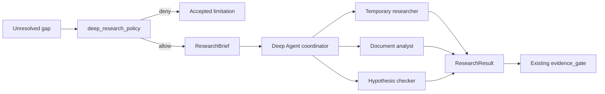

# Deep Agents в AI-ECOM

## 1. Роль в целевой архитектуре

Deep Agents — опциональный research worker внутри управляемого LangGraph `commerce_agent`. Он вызывается только нодой `deep_research`, получает ограниченный research brief и возвращает один типизированный `ResearchResult` в общий `CommerceState`.

Deep Agent не является главным orchestrator, не заменяет фиксированные domain subgraphs и не принимает окончательные business decisions. Общая архитектура и глобальный Definition of Done находятся в [корневом README](../README.md).

`M5` — отдельная необязательная capability после основного graph (`M4`). Первый production cutover и `M8` acceptance не зависят от реализации Deep Agent: до собственного acceptance policy gate выключен, а основной workflow возвращает явное limitation/`needs_data` для research gaps.

## 2. Почему выбран этот слой

Некоторые задачи невозможно эффективно разложить заранее на фиксированный набор шагов: неизвестная аномалия, большой набор документов, новое конкурентное окружение, поиск и проверка нескольких гипотез. Для них полезны возможности Deep Agents:

- динамическое планирование и todo tracking;
- временные subagents с изолированным контекстом;
- context offloading и summarization;
- виртуальная filesystem для больших артефактов;
- sandbox для безопасной обработки файлов/кода;
- skills и долгие исследовательские траектории;
- human-in-the-loop для чувствительных tools;
- streaming coordinator/subagent progress.

Для фиксированной коммерческой аналитики эти свойства дают лишнюю недетерминированность. Поэтому harness используется локально и подчиняется graph policy.

## 3. Текущее состояние

Текущий runtime выполняет primary, cross-check и gap-resolution agents по заранее заданной логике. Исследовательские задачи реализуются теми же domain agents, prompts и tools, хотя их характер может требовать динамического плана, большого контекста или обработки артефактов.

Уже существующие механизмы, которые нужно сохранить:

- read-only domain tool allowlists;
- evidence и source requirements;
- blocking/non-blocking gaps;
- limits на раунды и вызовы;
- document-agent и browser/parser boundaries;
- observability, redaction и audit.

Deep Agents добавляют отдельный режим исследования, но не расширяют автоматически права существующих tools.

## 4. Желаемый результат

`gap_resolution` или другой явно разрешённый graph node создаёт `ResearchBrief`. Policy node решает, достаточно ли фиксированных domain checks или требуется Deep Agent.



Все subagents временны, изолированы и не становятся новыми постоянными AI-ECOM domains. `ResearchResult` рассматривается как кандидат evidence и обязан пройти тот же evidence gate, что и результаты фиксированных агентов.

## 5. Что изменяется

### Разрешённые сценарии

- исследование неизвестной или междоменной аномалии, которую не закрыли фиксированные проверки;
- анализ большого набора документов и артефактов;
- конкурентное исследование вне готовой витрины;
- генерация, ранжирование и проверка гипотез;
- подготовка research brief для нового источника данных;
- задачи, где план невозможно надёжно определить до получения первых результатов.

### Запрещённые сценарии

- расчёт финансовых, supply, sales, price или marketing метрик вместо утверждённых SQL/calculators;
- принятие окончательного `ManagerDecision`;
- изменение цены, ставки, кампании, поставки, себестоимости или task status;
- прямой вызов WB write APIs;
- замена `sales`, `marketing`, `supply`, `price`, `finance` subgraphs;
- самостоятельное расширение tool permissions;
- использование persistent memory как неаудируемого источника бизнесовых фактов.

### Policy gate

Deep research разрешается, только если одновременно выполнены условия:

1. существует unresolved gap или явный research intent;
2. фиксированные checks не могут получить нужный факт существующими tools;
3. research имеет сформулированную цель и stop conditions;
4. разрешены источники и классы tools;
5. оценочный бюджет не превышает лимит run;
6. результат можно представить через `ResearchResult` и проверить evidence gate.

### Execution boundaries

- Main agent и каждый subagent получают отдельный allowlist.
- По умолчанию доступны только read-only search/document/domain tools.
- Filesystem изолирована на thread/run; запрещены host paths, `.env`, credentials и application source, если это не отдельный утверждённый сценарий.
- Shell/code execution допускается только в disposable sandbox без production network credentials.
- Весь выход проходит secret/PII redaction до checkpoint и stream.
- Event streaming Beta скрывается за локальным adapter; публичные UI/domain типы не импортируются из Beta API.

### Бюджеты по умолчанию

| Ограничение | Значение |
| --- | --- |
| Одновременные subagents | не более 3 |
| Общие subagent delegations | не более 5 на research run |
| Глубина nested delegation | 1 уровень |
| Research wall-clock timeout | 10 минут |
| Повтор transient tool/model call | не более 2 |
| Артефакт в streamed/checkpoint state | только summary + safe reference, не raw large payload |

Token/cost budget задаётся model profile и проверяется до каждой новой delegation. При исчерпании бюджета возвращается partial `ResearchResult` с limitation, а не бесконечное продолжение.

## 6. Что не переносится в этот слой

- Постоянные domain prompts как динамические subagent roles.
- Query routing всего продукта.
- Evidence acceptance и confidence finalization.
- Business memory/chat history как filesystem memory.
- Simulation engines и численные расчёты.
- Approval policy и action execution.
- Provider/user secrets.
- Raw production database access вне существующих scoped read-only tools.

## 7. Публичные интерфейсы и данные

### Input: `ResearchBrief`

```python
class ResearchBrief(BaseModel):
    brief_id: str
    question: str
    reason: str
    target_gap_ids: list[str]
    allowed_source_types: list[str]
    allowed_tools: list[str]
    required_evidence: list[str]
    stop_conditions: list[str]
    deadline_seconds: int
    max_subagents: int
    max_delegations: int
```

### Output: `ResearchResult`

```python
class ResearchResult(BaseModel):
    brief_id: str
    status: Literal["completed", "partial", "failed", "cancelled"]
    summary: str
    findings: list[ResearchFinding]
    evidence: list[EvidenceItem]
    limitations: list[ResearchLimitation]
    sources: list[ResearchSource]
    proposed_checks: list[ProposedCheck]
    confidence: float | None
    usage: ResearchUsage
```

Требования:

- `confidence` — самооценка research worker, а не финальный `ConfidenceReport`.
- Каждый finding с фактическим утверждением ссылается на evidence/source либо маркируется hypothesis.
- Sources содержат безопасные ссылки/идентификаторы, дату получения и тип источника.
- `usage` фиксирует модель, число delegations, tools, duration и доступный cost/token telemetry.
- Raw chain-of-thought не сохраняется и не показывается; UI получает status, сообщения/summary, tools и артефакты, допустимые policy.

### UI adapter

Adapter преобразует `stream.subagents` и Beta lifecycle в устойчивые AI-ECOM view models:

```ts
type ResearchWorkerView = {
  id: string;
  name: string;
  taskSummary: string;
  status: "started" | "completed" | "failed" | "interrupted";
  safeToolCalls: ToolCallView[];
};
```

## 8. Связь с соседними README

- [LangGraph](../langgraph/README.md) решает, можно ли вызвать `deep_research`, управляет timeout/checkpoint и принимает `ResearchResult`.
- [Frontend SDK](../langchain-frontend-sdk/README.md) показывает research workers через устойчивый adapter и отдельно от domain statuses.
- [Существующая платформа](../existing-platform/README.md) предоставляет разрешённые read-only tools, storage references, sandbox boundary и redaction.
- [Корневой README](../README.md) запрещает Deep Agent участвовать в write-контуре и финальном decision вне evidence gate.

## 9. Этапы реализации

Этот список выполняется как отдельный `M5` release, который может следовать после первого production cutover. До него staging проверяет disabled path: `deep_research` не запускает subagents/tools, не создаёт write side effects и не блокирует фиксированные domain workflows.

1. Собрать каталог research use cases и negative cases из существующего regression corpus.
2. Определить `ResearchBrief`, `ResearchResult` и evidence integration tests.
3. Реализовать `deep_research_policy` без вызова модели; policy должен быть тестируемым и deny-by-default.
4. Создать Deep Agent с минимальным read-only allowlist и фиксированными limits.
5. Подключить disposable sandbox/filesystem backend только для нужных use cases.
6. Интегрировать result с evidence gate; partial/failure преобразовать в limitation/gap.
7. Добавить event adapter и frontend fixtures.
8. Провести prompt-injection, exfiltration, permission, runaway delegation, timeout и cost tests.
9. Включить в staging только для allowlisted intents; подтвердить полезность по сравнению с fixed graph.
10. Разрешить production invocation после выполнения локального и глобального Definition of Done.

## 10. Риски и rollback

- **Избыточная автономность:** deny-by-default policy, fixed budgets, no write tools.
- **Prompt injection из документов/web:** помечать внешние данные как untrusted, не позволять им менять permissions/system policy.
- **Exfiltration:** sandbox/network allowlist, secret canaries и server-side redaction.
- **Runaway cost:** hard delegation/timeout/token limits и budget telemetry.
- **Недостоверные sources:** evidence gate, source metadata, запрет подтверждать finding без evidence.
- **Beta event contract:** adapter + pinned version + contract fixtures.
- **Subagent failure:** вернуть partial/failed result; основной graph продолжает работу с limitation.

Откат Deep Agents выполняется отключением policy gate: graph принимает research gap как limitation и продолжает synthesis по доступным проверенным данным. Это не требует отката всего `commerce_agent`.

## 11. Definition of Done

- Deep Agent вызывается только через `deep_research_policy` и только для разрешённых use cases.
- Ни main agent, ни subagents не видят WB/business write-tools.
- `ResearchResult` валидируется схемой и проходит существующий evidence gate.
- Failed/timeout/cancelled research не делает весь workflow terminal failed, если research не был обязательным product requirement.
- Limits на subagents, delegations, depth, timeout и retries проверены автоматическими тестами.
- Prompt-injection и secret-canary tests не приводят к расширению permissions или утечке.
- UI использует устойчивый adapter, а не Beta-типы как public contract.
- Usage/cost observability доступна для каждого research run.
- Отключение Deep Agents не ломает фиксированный Commerce Graph.
- `M5` включается в production только после собственного acceptance; его `NOT_STARTED`/`IN_PROGRESS` не препятствует первому cutover при доказанном disabled path.

## 12. Официальные источники

- [Deep Agents overview](https://docs.langchain.com/oss/python/deepagents/overview)
- [Frameworks, runtimes and harnesses](https://docs.langchain.com/oss/python/concepts/products)
- [Deep Agents production guide](https://docs.langchain.com/oss/python/deepagents/going-to-production)
- [Deep Agents event streaming](https://docs.langchain.com/oss/python/deepagents/event-streaming)
- [Deep Agents frontend](https://docs.langchain.com/oss/javascript/deepagents/frontend/overview)
- [Deep Agents GitHub and security model](https://github.com/langchain-ai/deepagents)
- [LangGraph frontend patterns](https://docs.langchain.com/oss/python/langgraph/frontend/overview)
