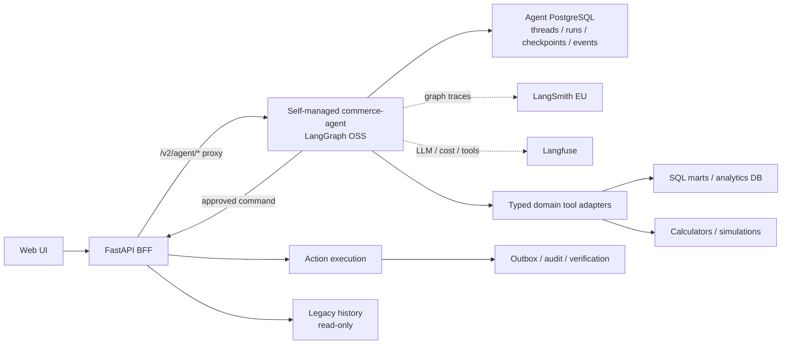

# Существующая платформа в целевой архитектуре

## 1. Роль в целевой архитектуре

Существующая платформа остаётся бизнес-ядром AI-ECOM. FastAPI отвечает за auth, tenant boundary, BFF/proxy и business APIs; PostgreSQL/SQL marts и calculators — за факты и вычисления; simulations — за сценарную оценку; action execution/outbox/audit — за безопасные внешние изменения.

LangGraph заменяет только agent orchestration/runtime. Он не переносит бизнесовую математику и side effects в LLM. Общая архитектура и глобальный Definition of Done определены в [корневом README](../README.md).

## 2. Почему выбран этот слой

В проекте уже реализованы и протестированы критические возможности, которые agent framework не должен дублировать:

- FastAPI routes, Pydantic contracts и auth;
- аналитические PostgreSQL schemas и agent-ready marts;
- finance, supply, pricing и commission calculations;
- decision simulation engines;
- action candidates, approvals, idempotency и external write guardrails;
- outbox, audit, read-after-write verification и lifecycle jobs;
- legacy chat/history и agent-run records;
- observability, redaction и correlation.

Сохранение этих компонентов уменьшает миграционный риск и оставляет LLM в роли анализа/оркестрации, а не источника чисел или транзакционных гарантий.

## 3. Текущее состояние

FastAPI предоставляет REST/WebSocket chat, agent-run status/details, dashboard, finance, simulations, experiment programs, actions и manager APIs. Redis/RQ выполняет agent runs и фоновые jobs. Memory PostgreSQL хранит chats, messages, traces, rounds, questions, responses, gaps, action tasks и execution records.

Основные runtime entrypoints текущего agent path:

- `agi_ecom_app/runner.py` — custom multi-agent workflow;
- `agi_ecom_app/main_agent.py` — agent definitions/orchestration helpers;
- `agi_ecom_app/agent_queue.py` — RQ agent execution/recovery;
- `agi_ecom_app/websocket_chat.py` — собственный realtime/reconnect;
- `agi_ecom_app/services/memory.py` — chat/run persistence;
- `agi_ecom_app/action_execution.py` и manager/simulation modules — business execution/evaluation.

Репозиторий содержит незавершённые пользовательские изменения; миграция должна разделяться на небольшие reviewable commits и не перезаписывать несвязанные правки.

## 4. Желаемый результат



FastAPI остаётся единственной границей между пользовательской сессией, self-managed runtime и внешними business systems. Observability/model credentials не попадают в browser. Business writes выполняются только локальными сервисами с текущими safety-гарантиями.

## 5. Что изменяется

### Матрица `keep / adapt / retire`

| Компонент | Решение | Целевое состояние |
| --- | --- | --- |
| FastAPI app и business routers | Keep | BFF, auth, business API, `/v2/agent/*` proxy |
| Analytics PostgreSQL и SQL marts | Keep | Source of truth, без переноса в graph checkpoint state |
| Agent PostgreSQL | Add | Отдельные threads, runs, protocol event log и LangGraph checkpoints; не смешивается с analytics/memory schemas |
| Domain calculators | Keep | Вызываются typed tools/adapters |
| Decision simulations | Keep | Детерминированные services/jobs, результаты возвращаются graph |
| Action execution | Keep | Единственный write path после interrupt |
| Outbox, audit, idempotency, verification | Keep | Обязательны для каждого side effect |
| Domain tools | Adapt | LangChain-compatible typed read-only adapters |
| Auth/tenant context | Adapt | Прокидывается в `commerce-agent` как verified runtime context/metadata |
| Observability/redaction | Adapt | Общая correlation LangSmith + Langfuse, redaction до checkpoint/trace/stream |
| Legacy chat/run tables | Keep read-only | История до cutover, без новых записей agent runtime |
| OpenAI Agents SDK | Retire | OpenAI остаётся допустимым model provider через LangChain |
| `runner.py` custom orchestration | Retire | Заменяется `commerce_agent` graph |
| Agent RQ queue/recovery | Retire from agent path | RQ сохраняется для не-agent jobs, если требуется |
| `/v1/chat/ws` | Retire | Новый realtime идёт через Frontend SDK/Agent Streaming Protocol |
| `/v1/chat/messages` POST | Retire | Новые inputs создают `commerce-agent` runs через `/v2/agent/*` |
| Legacy history GET | Keep read-only | Отдельный legacy history view |

### Новый BFF boundary

`/v2/agent/*` является authenticated gateway для зафиксированного в `M1.5` Agent Streaming Protocol contract, реализованного self-managed `commerce-agent`. Это не готовый managed Agent Server: `commerce-agent` отдельно реализует команды, durable runs, filtered SSE и replay. BFF:

- аутентифицирует текущего пользователя;
- определяет `tenant_id`, `user_id`, roles и correlation ID;
- запрещает доступ к чужим threads/runs, включая commands, subscriptions, state и history; идентификатор thread, предложенный браузером/SDK, не является доказательством ownership;
- хранит LangSmith, Langfuse и runtime service credentials только server-side;
- проксирует incremental stream без buffering;
- применяет rate limits, request size limits и safe logging;
- преобразует только auth/network errors, но не переписывает graph state/event semantics в legacy chat events.

В `M1.5` создаётся минимальный development/staging BFF route для stub graph и проверки `@langchain/react` v1: `POST /threads/{id}/commands`, `POST /threads/{id}/stream`, state/history hydration, sequence replay после restart/смены worker и negative tenant tests. Это ещё не production BFF и не переключение traffic. `M6` расширяет уже доказанный путь до полного policy, history, rate/size limits и operational readiness. Если выбранный SDK не проходит контрактные тесты, `M2` не начинается.

Business routes (`finance`, `simulations`, `actions`, WB integrations и другие доменные endpoints) остаются отдельными от `/v2/agent/*`.

### Domain tool adapters

Каждый tool получает typed input, verified runtime context и возвращает typed safe result. Adapter обязан:

- enforce tenant/data scope;
- использовать существующий service/repository вместо копирования SQL;
- быть read-only по умолчанию;
- включать source/grain/period/freshness metadata;
- ограничивать размер результата и возвращать safe reference для больших payloads;
- маскировать secrets/PII до возврата;
- использовать существующие timeouts и connection pools.

### Write path

Graph может сформировать только `ActionProposal`. После interrupt BFF передаёт одобренную команду существующему action service. Обязательная цепочка:

```text
proposal -> interrupt -> user decision -> preflight -> idempotency
-> outbox/write -> read-after-write verification -> audit receipt
```

Checkpoint или LLM-output не являются доказательством фактического выполнения; источник истины — локальный execution receipt и состояние внешней системы.

### Legacy data

- После cutover legacy chat/run tables переходят в read-only режим для приложения.
- Старые sessions/messages/traces отображаются отдельным legacy view.
- Они не импортируются в новые agent threads и не используются как checkpoint state.
- Новые agent PostgreSQL threads не синхронизируются обратно в legacy tables.
- Retention/backup политики применяются независимо к legacy DB, agent PostgreSQL и observability providers.

## 6. Что не переносится в этот слой

FastAPI/BFF не должен:

- реализовывать второй graph state machine;
- преобразовывать LangGraph events в старые WebSocket events;
- принимать решение, какие domain agents запускать;
- хранить новый authoritative thread/checkpoint state локально;
- выполнять research orchestration;
- выдавать browser service-level LangSmith/Langfuse/runtime credentials.

Business services не должны зависеть от внутреннего расположения graph nodes или SDK event version.

## 7. Публичные интерфейсы и данные

### Новый runtime API

```text
External UI prefix: /v2/agent/*
Upstream: self-managed commerce-agent API
Graph/assistant ID: commerce_agent
Auth: existing FastAPI authenticated user
```

Разрешённые классы операций:

- commands для start/cancel/interrupt resume только в owned thread;
- filtered stream с durable `since`/sequence replay для owned thread;
- get state/history с owner filter и hydration;
- create/search/get owned threads/runs там, где это требуется утверждённым UI contract;
- health/readiness.

Произвольный административный runtime API через публичный prefix не проксируется.

### Context mapping

| Источник | Runtime context/metadata |
| --- | --- |
| Auth identity | `user_id`, roles |
| Tenant resolver | `tenant_id` |
| Request middleware | `request_id`, trace correlation |
| Runtime settings | model profile, locale, feature/policy versions |

Client payload не может переопределить verified fields.

### Legacy API после cutover

| Endpoint class | Статус |
| --- | --- |
| Chat/session history GET | Read-only legacy |
| Agent trace/run detail GET | Read-only legacy |
| Chat message POST | Disabled (`410 Gone` или удалён из публичной маршрутизации) |
| `/v1/chat/ws` | Disabled/removed |
| Finance/simulation/action/WB APIs | Сохраняются по текущим контрактам |

Точный список legacy GET фиксируется перед cutover по фактическим UI-зависимостям; write endpoints не остаются скрытым fallback runtime.

## 8. Связь с соседними README

- [LangGraph](../langgraph/README.md) вызывает typed adapters и action boundary, но не владеет их бизнесовой реализацией.
- [Frontend SDK](../langchain-frontend-sdk/README.md) подключается к self-managed runtime только через `/v2/agent/*` и использует business APIs отдельно.
- [Deep Agents](../deep-agents/README.md) получают только scoped read-only tools/sandbox и проходят общую redaction policy.
- [Корневой README](../README.md) определяет big-bang cutover, общий state и глобальный Definition of Done.

## 9. Этапы реализации

1. Инвентаризировать текущие chat/runtime/business routes, tables, queues и frontend consumers.
2. Зафиксировать baseline business outputs и regression fixtures до изменения adapters.
3. Выделить существующие domain services из OpenAI Agents-specific wrappers.
4. Реализовать LangChain-compatible read-only tool adapters и contract tests.
5. Сразу после `M1` выполнить `M1.5`: минимальный authenticated `/v2/agent/*` gateway и stub UI, pinned v1 SDK, restart/cross-worker/replay и tenant tests без production traffic.
6. После `M4` расширить gateway в `M6` до полного production contract с owner filters, streaming, history и safe logs.
7. Подключить action proposal/interrupt к существующему action service и receipts.
8. Добавить общую LangSmith/Langfuse correlation, redaction и secret-canary tests.
9. Подготовить read-only legacy history routes/view и запрет новых legacy writes.
10. Провести staging load/security/rollback rehearsal совместно с graph/frontend; в cutover release отключить legacy POST/WS, затем после 72-часового окна вывести старый agent path из активной конфигурации.

## 10. Риски и rollback

- **BFF streaming timeout/buffering:** production-like ingress tests и корректные proxy settings.
- **Tenant escape:** server-side owner filters на каждую thread/run operation, negative tests.
- **Checkpoint/trace exposure:** server-side redaction, secret canaries, минимальный state, отдельные retention policies.
- **Расхождение business results:** adapters вызывают существующие services, regression fixtures сравниваются до cutover.
- **Duplicate writes после resume:** idempotency + receipt lookup + outbox uniqueness.
- **Legacy hidden fallback:** после cutover POST/WS явно отключены; frontend не выбирает runtime автоматически.
- **Dirty repository migration:** отдельные commits по BFF, tools, graph, frontend и retirement; не смешивать с несвязанными изменениями.

Rollback:

1. остановить приём новых `/v2/agent` runs;
2. вернуть предыдущие backend/worker/UI images и routing;
3. проверить health legacy API/queue;
4. сохранить agent PostgreSQL threads read-only для аудита без импорта;
5. сверить все action receipts, выполненные после cutover;
6. восстановить пользовательский доступ к legacy UI.

## 11. Definition of Done

- FastAPI успешно проксирует обязательное SDK-подмножество Agent Protocol без раскрытия service credentials.
- До переноса domain tools/agents пройден `M1.5`: BFF и self-managed service подтверждают совместимый v1 command/stream/state контракт, cross-worker sequence replay и owner isolation на stub graph.
- Tenant/user isolation подтверждена positive/negative integration tests.
- Все graph tools используют существующие services/marts и возвращают type-safe/redacted results.
- Результаты finance, supply, price, simulations и action validation совпадают с baseline fixtures.
- Внешние actions выполняются только через существующий executor, outbox, audit и verification.
- Legacy history доступна read-only; новые записи через legacy POST/WS невозможны.
- Agent RQ queue и OpenAI Agents SDK не участвуют в новых production runs.
- Non-agent RQ jobs продолжают работать либо имеют явно задокументированную замену.
- Одинаковые `thread_id`, `run_id` и `request_id` присутствуют в безопасных backend logs, LangSmith traces и Langfuse observations.
- Rollback rehearsal проходит без потери legacy data и без повторения side effects.

## 12. Официальные источники

- [Agent Protocol](https://github.com/langchain-ai/agent-protocol)
- [Frontend SDK custom transport](https://github.com/langchain-ai/langgraphjs/blob/main/libs/sdk-react/docs/custom-transport.md)
- [LangGraph persistence](https://docs.langchain.com/oss/python/langgraph/persistence)
- [LangSmith tracing with LangChain](https://docs.langchain.com/langsmith/trace-with-langchain)
- [Langfuse LangGraph integration](https://langfuse.com/guides/cookbook/integration_langgraph)
- [LangGraph application structure](https://docs.langchain.com/oss/python/langgraph/application-structure)
- [FastAPI documentation](https://fastapi.tiangolo.com/)
- [Корневой README AI-ECOM](../../../README.md)
- [Текущее резюме проекта](../../project-summary.md)
