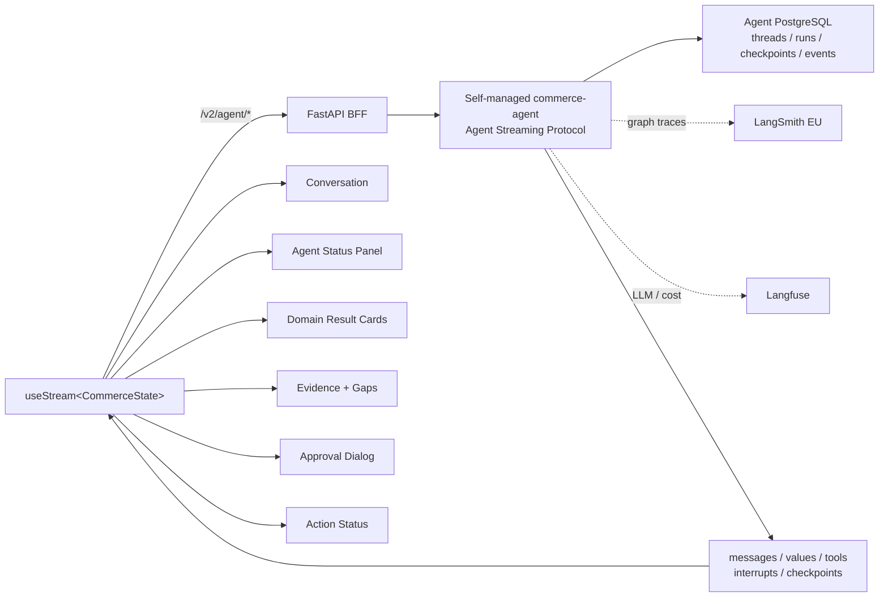

# LangChain Frontend SDK для AI-ECOM

## 1. Роль в целевой архитектуре

LangChain Frontend SDK (`@langchain/react`) становится единственным realtime-контрактом нового React Web UI с agent runtime. Он отображает durable thread state, node/subagent lifecycle, messages, tool calls, interrupts и checkpoint history графа `commerce_agent`.

Общие архитектурные решения, state contract и cutover определены в [корневом README](../README.md). Frontend не создаёт собственную модель выполнения поверх wire events и не является источником истины для agent state.

## 2. Почему выбран этот слой

Текущий UI работает как чат: собственный WebSocket hook принимает ограниченный набор событий и локально связывает пользовательское сообщение с итоговым ответом. Для AI-ECOM нужен интерфейс процесса:

- статусы Sales/Marketing/Supply/Price/Finance;
- structured domain results, incidents, evidence и gaps;
- tool lifecycle;
- checkpoints и history;
- reconnect/rejoin к уже идущему run;
- human approval с продолжением того же thread;
- отдельное отображение graph subgraphs и Deep Agent delegations.

Frontend SDK предоставляет эти проекции из совместимого Agent Streaming Protocol; self-managed LangGraph сам по себе такой серверный API не предоставляет. Новый браузерный state machine не нужен, но совместимость backend с SDK должна быть доказана до переноса бизнес-агентов (`M1.5`).

## 3. Текущее состояние

В соседнем Web UI используется `useChatConnection`, native `WebSocket`, Zod-схема собственных chat events и Zustand store сообщений. Backend предоставляет `/v1/chat/ws`, heartbeat, reconnect, `message.accepted`, `message.queued`, `run.status`, `message.completed` и terminal errors.

Ограничения текущего пути:

- WebSocket сообщает общий status run, а не lifecycle каждой ноды;
- graph/domain state приходится дополнительно запрашивать и собирать;
- tool calls, interrupts и checkpoints не имеют единого UI-контракта;
- reconnect восстанавливает последний run частным backend-кодом;
- frontend и backend event schemas могут расходиться;
- локальный message store смешивает transport, conversation и execution state.

## 4. Желаемый результат

React UI использует `@langchain/react` v1 через BFF. Для self-managed backend исходный кандидат — штатный `HttpAgentServerAdapter`, а не неявное предположение о наличии managed Agent Server:

```tsx
import { HttpAgentServerAdapter, useStream } from "@langchain/react";
import { useMemo, useState } from "react";

function CommerceChat() {
  const [threadId, setThreadId] = useState<string | null>(null);
  const transport = useMemo(
    () => new HttpAgentServerAdapter({ apiUrl: "/v2/agent" }),
    [],
  );
  const stream = useStream<CommerceState>({
    transport,
    assistantId: "commerce_agent",
    threadId,
    onThreadId: setThreadId,
  });
  // Render stream.messages, stream.values and interrupt controls here.
  return null;
}
```

Это схема интеграции, а не готовый production component: в `M1.5` нужно зафиксировать конкретные версии SDK, проверить компиляцию и wire contract, восстановление `threadId` из route/UI identity и доступность state/history через BFF. В v1 `reconnectOnMount` и `fetchStateHistory` удалены: rejoin выполняется при повторном mount с тем же `threadId`, а checkpoint history запрашивается отдельно. Не смешивать `apiUrl` как option `useStream` (ветка managed/LGP client) с `transport: HttpAgentServerAdapter` (ветка custom backend); здесь `apiUrl` является опцией самого adapter.

Логическая схема:



Browser отправляет пользовательский bearer/session token только BFF. LangSmith, Langfuse и model-provider credentials существуют только в server-side environment/secret store.

## 5. Что изменяется

### Transport

- Добавить `@langchain/react` и совместимые LangChain message types.
- Закрепить точные совместимые версии `@langchain/react` и protocol/server adapter в lockfiles. Для custom backend настроить `HttpAgentServerAdapter({ apiUrl: "/v2/agent" })` и graph identity `commerce_agent`; окончательный вариант подтвердить `M1.5` contract tests.
- BFF аутентифицирует и маршрутизирует проверенные Agent Streaming Protocol команды и SSE через `/v2/agent/*` без буферизации. Он не создаёт graph events из legacy chat events.
- Self-managed runtime хранит event sequence и обеспечивает replay при поздней подписке, смене worker и restart; PostgreSQL checkpoint без durable event log не закрывает rejoin.
- Удалить новый chat flow из `useChatConnection`, native WebSocket event parsing и reconnect timers.
- Не преобразовывать SDK stream обратно в старые `message.queued/run.status` события.

### State ownership

Разделить UI state:

| Состояние | Источник |
| --- | --- |
| Messages, graph values, active run, tools, interrupt | Frontend SDK / `commerce-agent` thread в agent PostgreSQL |
| Checkpoint history | Отдельный authorized BFF query к `commerce-agent`, не `stream.history` |
| Draft, panel visibility, local filters, selected card | Локальный React/Zustand UI state |
| Authenticated user/tenant | FastAPI auth session |
| Legacy chat history | Read-only legacy API |
| Business objects/actions after execution | Существующие business APIs |

Frontend не должен копировать весь `stream.values` в отдельный mutable Zustand store. Derived selectors допустимы; authoritative state остаётся в stream handle.

### Обязательные компоненты

1. **Conversation:** сообщения coordinator и финальный synthesis.
2. **Agent Status Panel:** фиксированные `sales`, `marketing`, `supply`, `price`, `finance`; состояния `pending`, `running`, `completed`, `failed`, `skipped`, `interrupted`.
3. **Domain Result Cards:** отдельные typed renderers для пяти domain result полей.
4. **Evidence and Gaps:** evidence matrix, blocking/non-blocking gaps, limitations и confidence.
5. **Tool Call Cards:** tool name, безопасный input summary, running/completed/failed; raw secrets и большие payloads не показываются.
6. **Approval Dialog:** тип операции, target, proposed values, checks, risk, approve/edit/reject.
7. **Action Status:** receipt, idempotency status, verification и ссылка на business audit.
8. **Reconnect State:** connecting/rejoining/streaming/interrupted/completed/offline без пометки user message как failed при кратком разрыве.
9. **Checkpoint History:** отдельный authorized BFF history query; v1 hook не возвращает `stream.history`. Read-only audit/branch navigation только там, где включено product policy; production action branches не могут обходить approval.
10. **Deep Research Panel (`M5`, после отдельного acceptance):** `stream.subagents` v1 — map discovery snapshots, а сообщения/values/tools конкретного subagent читаются через selector hooks; не смешивать их с фиксированными domain agents. Не является блокером первого cutover; до включения `M5` UI безопасно показывает research limitation/`needs_data`.

### UI mapping

```ts
type CommerceState = {
  schema_version: number;
  messages: BaseMessage[];
  query_plan: QueryPlan | null;
  agent_statuses: Record<DomainAgentName, AgentStatus>;
  sales_analysis: SalesAnalysis | null;
  marketing_analysis: MarketingAnalysis | null;
  supply_analysis: SupplyAnalysis | null;
  price_analysis: PriceAnalysis | null;
  finance_analysis: FinanceAnalysis | null;
  research_result: ResearchResult | null;
  detected_incidents: Incident[];
  evidence_matrix: EvidenceItem[];
  data_gaps: DataGap[];
  action_tasks: ActionTask[];
  confidence: ConfidenceReport | null;
  manager_decision: ManagerDecision | null;
  pending_interrupt: ApprovalRequest | null;
  execution_receipts: ActionReceipt[];
  errors: WorkflowError[];
};
```

Типы генерируются либо вручную синхронизируются из versioned JSON Schema, опубликованной graph package. TypeScript compilation должна падать при несовместимом изменении обязательного поля.

## 6. Что не переносится в этот слой

- Router, planning, evidence и decision logic.
- Расчёты confidence, finance, supply, pricing или simulation outcomes.
- Хранение LangSmith, Langfuse или model-provider credentials.
- Авторизация tenant/thread ownership на доверии к клиенту.
- Выполнение внешних actions.
- Самостоятельное восстановление state из набора низкоуровневых events.
- Автоматическое создание UI-компонентов из произвольного LLM-кода.

UI только визуализирует и управляет разрешёнными переходами runtime.

## 7. Публичные интерфейсы и данные

### Runtime endpoint

```text
Browser base URL: /v2/agent
Assistant ID: commerce_agent
Authentication: existing FastAPI user session/bearer token
```

BFF и self-managed runtime должны реализовать проверенный в `M1.5` контракт для выбранной версии SDK:

- `POST /threads/{thread_id}/commands`: start, cancel, interrupt resume и typed responses;
- `POST /threads/{thread_id}/stream`: filtered SSE с `channels`, `namespaces`, `depth`, `since` и устойчивым sequence/event ID для replay;
- read thread state для hydration и отдельный authorized history query;
- create/search/get owned threads и runs там, где этого требует принятый UI contract;
- health/error mapping.

BFF обязан фильтровать каждый thread/run command, subscription, state и history access по verified `tenant_id` и `user_id`, включая первый запрос с выданным SDK `thread_id`; client-generated ID не доказывает ownership. BFF передаёт correlation ID и исключает service credentials из response/logs.

### Error contract

| Ситуация | UI-поведение |
| --- | --- |
| Временный network failure | Показать rejoining, не завершать run локально |
| Run terminal failure | Показать typed workflow error и доступный retry policy |
| Unauthorized/thread mismatch | Закрыть stream, очистить runtime view, показать access error |
| Interrupt | Открыть approval UI, не считать run завершённым |
| State schema mismatch | Остановить renderer, показать upgrade-required и отправить telemetry |
| BFF/runtime/PostgreSQL unavailable | Offline state + retry; не переключаться на legacy runtime автоматически |

## 8. Связь с соседними README

- [LangGraph](../langgraph/README.md) определяет state, nodes, lifecycle и Agent Protocol semantics, которые отображает UI.
- [Deep Agents](../deep-agents/README.md) предоставляют user-facing research/subagent progress через изолированный adapter.
- [Существующая платформа](../existing-platform/README.md) реализует `/v2/agent/*`, auth и business APIs.
- [Корневой README](../README.md) определяет общий cutover, state contract и глобальные метрики.

## 9. Этапы реализации

1. В `M1.5` закрепить версию `@langchain/react` v1 и проверить thin client с `HttpAgentServerAdapter`, stub graph и authenticated BFF без production traffic; если stock adapter не подходит, задокументировать и протестировать другой v1-совместимый transport до `M2`.
2. В том же `M1.5` доказать create/start/stream, checkpoint hydration, interrupt/resume, disconnect/rejoin после restart и на другом worker, replay по sequence, tenant isolation и secret canaries. Наличие локального checkpoint не является выполнением этого шага.
3. Для `M7` зафиксировать TypeScript `CommerceState` и test fixtures; расширить проверенный transport до production UI, не подключая production traffic до cutover.
4. Реализовать Conversation и Agent Status Panel.
5. Добавить domain cards, evidence/gaps, tools и manager decision.
6. Добавить interrupt approval и action receipt UI.
7. Добавить rejoin, отдельную загрузку history и failure states.
8. После отдельного включения `M5` добавить Deep Research Panel через adapter, изолирующий Beta event types; первый release проверяет отсутствие subagent events при выключенном policy gate.
9. Прогнать browser, accessibility, auth, schema, reconnect и load tests.
10. В big-bang release переключить chat route на новый workspace; legacy history вынести в read-only view.

## 10. Риски и rollback

- **SDK/API evolution:** pin exact versions, использовать adapter boundary и contract fixtures; не возвращать удалённые v1 options `reconnectOnMount`/`fetchStateHistory`.
- **Self-managed protocol gap:** `M1.5` останавливает перенос domain agents, если команды, durable replay, selectors или cross-worker rejoin не проходят на pinned SDK.
- **Stream proxy buffering:** отключить buffering/compression там, где они мешают incremental delivery; проверить через production-like ingress.
- **Duplicate submit/resume:** client request ID + server idempotency; блокировка повторной кнопки не считается достаточной защитой.
- **Schema drift:** versioned JSON Schema и CI type test.
- **Sensitive tool output:** server-side redaction до stream; frontend masking только дополнительная защита.
- **Большой state:** рендерить selectors/virtualized lists, не копировать snapshots многократно.

Rollback возвращает предыдущие Web UI/backend images и `/v1/chat/ws`. Новый UI не пытается преобразовать agent PostgreSQL threads в legacy messages.

## 11. Definition of Done

- Все новые agent interactions используют `useStream<CommerceState>` и `/v2/agent`.
- Native WebSocket chat и `message.queued/run.status` не используются новым route.
- Reload, navigation away/back и временная потеря сети rejoin-ят существующий run без дубля сообщения.
- Rejoin после restart/смены worker воспроизводит непропущенные события по sequence ID; history загружается отдельным authorized запросом, а не из удалённого v1 hook property.
- UI отображает статусы пяти domain agents, structured results, evidence/gaps, tools и manager decision.
- Interrupt approve/edit/reject возобновляет тот же thread; повторная отправка не создаёт второй action.
- LangSmith/Langfuse/provider secrets отсутствуют в bundle, source maps, local/session storage, network responses и browser logs.
- Unauthorized пользователь не может получить чужой thread через изменение URL/ID.
- State schema mismatch и terminal failures имеют понятное безопасное состояние.
- Основные экраны проходят unit/component/browser и accessibility tests.
- Frontend latency/reconnect соответствует глобальным acceptance metrics.
- Первый cutover не требует Deep Research Panel, но отсутствие `M5` не ломает renderer, state schema или отображение `needs_data`.

## 12. Официальные источники

- [LangChain Frontend SDK overview](https://docs.langchain.com/oss/python/langchain/frontend/overview)
- [LangGraph frontend patterns](https://docs.langchain.com/oss/python/langgraph/frontend/overview)
- [Join and rejoin streams](https://docs.langchain.com/oss/python/langchain/frontend/join-rejoin)
- [Tool calling UI](https://docs.langchain.com/oss/python/langchain/frontend/tool-calling)
- [Branching chat](https://docs.langchain.com/oss/python/langchain/frontend/branching-chat)
- [Deep Agents frontend](https://docs.langchain.com/oss/javascript/deepagents/frontend/overview)
- [Agent Protocol](https://github.com/langchain-ai/agent-protocol)
- [Frontend SDK v1 migration](https://github.com/langchain-ai/langgraphjs/blob/main/libs/sdk-react/docs/v1-migration.md)
- [Frontend SDK custom transport](https://github.com/langchain-ai/langgraphjs/blob/main/libs/sdk-react/docs/custom-transport.md)
- [LangGraph persistence](https://docs.langchain.com/oss/python/langgraph/persistence)
