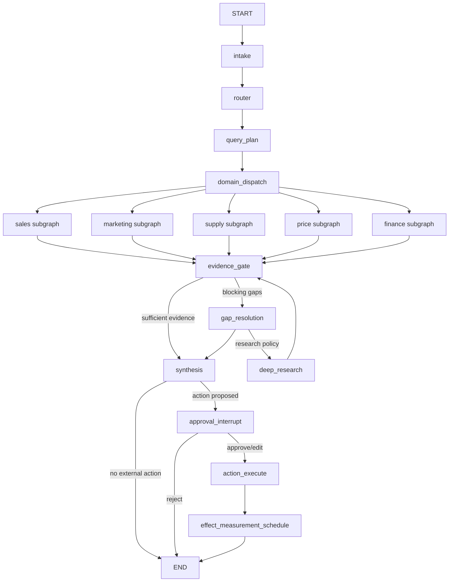

# LangGraph runtime для AI-ECOM

## 1. Роль в целевой архитектуре

LangGraph является единственным orchestration runtime для новых AI-ECOM agent runs. Он управляет порядком нод, параллельными ветками, typed state, checkpoints, retries, conditional routing, human interrupts и возобновлением выполнения. Общие решения и глобальные критерии определены в [корневом документе](../README.md).

LangGraph не является источником бизнесовых фактов и не заменяет SQL, calculators, simulation engines, outbox или action execution.

## 2. Почему выбран этот слой

Текущий workflow уже является графом по смыслу: router выбирает домен, domain agents выполняют параллельные проверки, evidence объединяется, gaps закрываются отдельными раундами, synthesis формирует решение, а рискованные действия требуют подтверждения. LangGraph предоставляет для этого стандартные primitives:

- durable threads и checkpoints;
- явные nodes, edges и subgraphs;
- reducers для параллельного state;
- interrupts с продолжением того же run;
- streaming state и lifecycle events;
- восстановление graph state от checkpoint;
- возможность публиковать graph events в отдельно реализованный Agent Streaming Protocol;
- LangSmith tracing для graph trace/debugging и Langfuse для LLM/tool/cost observability.

Это упрощает orchestration, не ослабляя доменные guardrails. Однако self-managed service по-прежнему должен реализовать durable run ownership, очередь/worker, protocol commands, event log и replay: этих возможностей не следует выводить из наличия LangGraph checkpointer.

## 3. Текущее состояние

Оркестрация распределена между `runner.py`, `main_agent.py`, `agent_queue.py`, memory tables и WebSocket transport. Доменные агенты работают через OpenAI Agents SDK; состояние выполнения представлено отдельными `agent_run_*` таблицами и итоговыми trace events. Часть recovery и очередей реализована через Redis/RQ и PostgreSQL `LISTEN/NOTIFY`.

Сохраняемые сильные стороны:

- фиксированный набор domain agents;
- типизированные domain outputs;
- required-tool policy;
- evidence и gap contracts;
- ограничение числа раундов и параллельности;
- детерминированные business services;
- idempotency, audit и action safety.

Проблема текущего состояния — эти возможности связаны частным контрактом и не дают frontend стандартного доступа к checkpoint/state/node lifecycle.

## 4. Желаемый результат

В отдельном self-managed service развёрнут graph с ID `commerce_agent`. Один пользовательский запрос соответствует run внутри durable thread; graph checkpoints, run registry и protocol events сохраняются в выделенной PostgreSQL database как разные persistence contracts. Run worker восстанавливает незавершённую работу по durable run record и checkpoint; stream endpoint воспроизводит события по sequence ID. LangSmith EU и Langfuse получают независимые fail-open traces, но не владеют выполнением или state.



## 5. Что изменяется

### Graph и nodes

- Создать отдельный Python package для graph, state, nodes, tool adapters и policies.
- Объявить `commerce_agent` в `langgraph.json`.
- Перенести существующую последовательность primary/cross-check/gap/synthesis в явные nodes и conditional edges.
- Представить каждый постоянный domain agent отдельным subgraph с собственным input/output contract.
- Реализовать `deep_research` как опциональную ноду за policy gate, а не как свободную замену domain fan-out.

### State и reducers

Верхнеуровневые поля должны совпадать с `CommerceState` из [корневого README](../README.md). Внутренние Pydantic-модели определяют `QueryPlan`, `AgentStatus`, domain results, evidence, gaps, actions, confidence, decision, interrupts, receipts и errors.

Reducer policy:

| Поле | Политика |
| --- | --- |
| `messages` | LangGraph `add_messages` |
| `agent_statuses` | merge только по ключу соответствующего агента |
| Domain result | replace владельцем поля, один authoritative result на run |
| `evidence_matrix`, `data_gaps`, `action_tasks` | append + deduplicate по устойчивому ID |
| `execution_receipts`, `errors` | append-only |
| `manager_decision`, `pending_interrupt`, `confidence` | replace соответствующей нодой-владельцем |

Параллельным веткам запрещено возвращать общий словарь целиком: каждая ветка пишет только свой status/result и append-only evidence.

### Checkpoint boundaries

Checkpoint должен существовать минимум после:

1. intake/router;
2. query plan;
3. завершения каждой domain branch;
4. evidence gate;
5. каждой попытки gap resolution;
6. deep research;
7. synthesis;
8. создания interrupt;
9. action receipt;
10. постановки effect measurement.

`schema_version` обязателен. Новая revision должна читать checkpoints текущей production-версии либо завершать старые in-flight runs до deployment. Несовместимое изменение state требует нового graph ID/revision migration, а не скрытого изменения reducer semantics.

### Deployment и persistence

- Development: `langgraph dev`, тестовые model credentials и synthetic data.
- Staging: отдельный `commerce-agent` image/service, production-like agent PostgreSQL и обезличенный regression corpus.
- Production: self-managed `commerce-agent`, graph ID `commerce_agent`, отдельная PostgreSQL database и server-side secret store.
- `langgraph.json` сохраняется как graph manifest и local development contract; production process lifecycle и persistence настраиваются нашим service deployment.
- Production graph компилируется с `AsyncPostgresSaver`; `.setup()` выполняется отдельным migration step, а не на каждом startup.
- Отдельные durable таблицы/контракты service фиксируют run lifecycle, ownership/concurrency и упорядоченные protocol events. `AsyncPostgresSaver` не заменяет их и не является SSE replay buffer.
- Checkpoint TTL: 30 дней; maintenance job сохраняет latest checkpoint thread и удаляет более старую history по проверенной retention policy.
- LangSmith и Langfuse projects разделяются по environment; exporter failure не меняет run status.
- Provider/API credentials читаются из secrets/runtime context; state хранит только безопасные идентификаторы.

### M1 security и environment gate

До возврата `M1` в `READY` и до подключения реальных входов:

- валидировать или отклонять credential-like значения на service ingress **до** вызова graph и подключения tracing callbacks; проверка в `intake` остаётся дополнительной защитой, но не защищает первый trace event;
- покрыть форматы используемых provider keys, включая синтетический `lsv2_` canary, и проверить, что они отсутствуют в messages, PostgreSQL checkpoints, streamed events, LangSmith traces и Langfuse observations;
- по умолчанию скрывать raw LangSmith trace inputs/outputs (`LANGSMITH_HIDE_INPUTS=true`, `LANGSMITH_HIDE_OUTPUTS=true`) и передавать только разрешённую redacted projection; для Langfuse отдельно настроить экспортное masking (Python `mask_otel_spans`); настройка одного exporter не защищает другой;
- запускать LangSmith только через явный callback с `COMMERCE_AGENT_LANGSMITH_TRACING=true`, оставляя SDK auto-tracing flags выключенными; экспортируемые run operations проходят финальную allowlist projection, которая удаляет ошибки, events, tags, attachments и неизвестные поля помимо I/O/metadata. При ошибке создания safety callback нельзя переходить к implicit tracer;
- отклонять invocation callbacks, произвольные `run_name`, tags и metadata в публичном graph config: иначе дополнительный exporter обходит projection, а пользовательское имя становится полем trace;
- подтвердить запуск self-managed service с отдельной PostgreSQL, сохранение checkpoint и resume после перезапуска процесса/БД, а также документировать backup/restore и rollback;
- повторить полный legacy regression с доступной БД, зафиксировать результаты в [журнале](../MIGRATION_STATUS.md) и включить package в отслеживаемую Git-версию;
- проверить, что LangSmith tracing использует согласованный EU API endpoint и EU workspace; текущий US endpoint нельзя считать выполнением EU-контракта без нового архитектурного решения.

До выполнения gate `M1` имеет статус `IN_PROGRESS`. Локальный `AsyncPostgresSaver` smoke и успешные unit tests являются полезным evidence, но не доказывают готовность self-managed run lifecycle в staging.

### `M1.5` — protocol feasibility до доменных subgraphs

После закрытия `M1`, но до `M2`, на stub graph выполнить сквозной development/staging spike `@langchain/react` v1 → authenticated FastAPI BFF → self-managed `commerce-agent` → PostgreSQL. Зафиксировать SDK/adapter versions и совместимые command/event schemas. Проверить start/stream, checkpoint hydration, interrupt/resume того же thread, cancellation, filtered subscription и sequence replay после disconnect, restart и смены worker; отдельно — tenant isolation и отсутствие secrets. После появления run/event schema проверить 30-дневную retention, сохраняющую latest state и active runs. Графовые ноды не выполняют business tools и writes. `M1.5` не включает production routing и не оправдывает retirement legacy path. При невыполнении gate перенос domain tools/agents останавливается до отдельного архитектурного решения.

### Failure model

- Model timeout: ограниченный retry с exponential backoff только для transient errors.
- Validation/tool-policy failure: не retry вслепую; записать typed error/gap и применить существующую repair policy.
- Domain branch failure: остальные ветки завершаются; evidence gate решает, blocking ли ошибка.
- Worker/process failure: durable run registry выбирает незавершённый run; self-managed worker возобновляет его от последнего PostgreSQL checkpoint, а новый stream догоняет события из durable журнала. Graph checkpoint без registry/event log недостаточен.
- Cancellation: terminal state `cancelled`, запрет новых tools, уже выполненные receipts сохраняются.
- Action retry: только с тем же idempotency key; receipt проверяется до повторного вызова.
- Deep research failure: non-fatal, преобразуется в limitation/gap.

## 6. Что не переносится в этот слой

- SQL-формулы, pricing/supply/finance calculations и prepared marts.
- Решение о допустимости внешнего side effect на уровне business policy.
- Хранение action audit/outbox и фактического состояния WB.
- Секреты и пользовательские access tokens.
- Старые chat/run records как источник нового thread state.
- Произвольное динамическое создание постоянных domain agents.

Graph вызывает существующие сервисы через тонкие typed adapters и получает данные/receipts; он не дублирует их реализацию.

## 7. Публичные интерфейсы и данные

### Graph identity

```text
assistantId / graph ID: commerce_agent
API prefix через BFF: /v2/agent/*
```

### Runtime context

```python
class CommerceRuntimeContext(TypedDict):
    tenant_id: str
    user_id: str
    roles: list[str]
    request_id: str
    locale: str
    model_profile: str
```

Контекст создаётся BFF после auth. Клиентские значения `tenant_id` и `user_id` игнорируются, если они не совпадают с verified identity.

### Node ownership

| Node/subgraph | Читает | Пишет |
| --- | --- | --- |
| `router/query_plan` | messages, context | query_plan |
| Domain subgraph | query_plan, разрешённый context | свой status, свой result, evidence/gaps |
| `evidence_gate` | domain results, research result | evidence matrix, gaps, confidence draft |
| `gap_resolution` | gaps, evidence | новые checks/evidence/gap status |
| `deep_research` | разрешённый research brief | research result |
| `synthesis` | validated evidence/gaps | incidents, actions, confidence, manager decision |
| `approval_interrupt` | action proposal, roles | pending interrupt/decision |
| `action_execute` | approved action | execution receipt |

## 8. Связь с соседними README

- [Frontend SDK](../langchain-frontend-sdk/README.md) читает state и lifecycle этого graph через проверенный Agent Streaming Protocol.
- [Deep Agents](../deep-agents/README.md) реализуют только ноду `deep_research` и возвращают `ResearchResult`.
- [Существующая платформа](../existing-platform/README.md) предоставляет BFF, tools, SQL, simulations и action executor.
- [Корневой README](../README.md) определяет общий контракт, cutover и глобальный Definition of Done.

## 9. Этапы реализации

1. Зафиксировать baseline и regression fixtures текущего runtime.
2. Создать state models/reducers и unit tests, затем skeleton graph без LLM (`M1`).
3. Выполнить `M1.5` с BFF и тонким React client до переноса domain tools; доказать protocol/replay/restart на stub graph.
4. Обернуть существующие read-only domain tools типизированными adapters.
5. Перенести domain agents по одному и подтвердить output parity.
6. Добавить evidence/gap/synthesis nodes и параллельный fan-out.
7. Добавить production interrupts, action adapter и idempotency tests.
8. При необходимости подключить Deep Agent за feature/policy gate как независимый `M5`; первый cutover допускает выключенный и протестированный `deep_research`.
9. Развернуть development и staging `commerce-agent` services с отдельными PostgreSQL databases.
10. Выполнить failure injection, regression, load, cost и security tests; расширить проверенный `M1.5` protocol contract до production BFF/frontend.

## 10. Риски и rollback

- **State incompatibility:** применять versioned schemas и проверять старые checkpoints перед revision rollout.
- **Parallel write conflicts:** строгая ownership/reducer policy и concurrency tests.
- **Повтор side effect после resume:** idempotency key и проверка receipt до action call.
- **Runtime/DB outage:** readiness checks, bounded timeouts, PostgreSQL backups и понятный UI status; production rollback возвращает legacy runtime целиком.
- **Observability outage:** LangSmith и Langfuse fail-open; локальные run/checkpoint/audit records остаются источником operational status.
- **Cost growth:** ограничить domain fan-out, retries, gap attempts и Deep Agent budget; сравнивать с baseline.
- **Sensitive state:** redaction до записи, canary tests, запрет secrets в tool outputs.

При общем rollback новые agent PostgreSQL threads не импортируются в legacy runtime. Фактические внешние действия восстанавливаются из локального audit/outbox, а не из checkpoint.

## 11. Definition of Done

- `commerce_agent` развёрнут как self-managed service в development, staging и production с отдельными PostgreSQL persistence boundaries.
- State и reducers покрыты unit/concurrency tests и совпадают с корневым контрактом.
- Все фиксированные domain subgraphs возвращают текущие typed outputs и проходят regression fixtures.
- Workflow возобновляется после принудительного падения на каждом обязательном checkpoint boundary.
- Run registry и protocol event replay возобновляют stream после worker/process restart, смены worker и поздней подписки без потери или дублирования событий; это подтверждено ранним `M1.5` gate и повторено на полном графе.
- Interrupt approve/edit/reject продолжает тот же thread; повторное resume не дублирует action.
- UI может определить active/completed/failed/interrupted status каждой значимой ноды.
- Никакая graph node не выполняет бизнесовый write в обход action service.
- Secrets не обнаруживаются в state, checkpoints, traces и streamed events.
- Latency, cost, terminal success и evidence gates соответствуют глобальному Definition of Done.

## 12. Официальные источники

- [LangGraph overview](https://docs.langchain.com/oss/python/langgraph/overview)
- [LangGraph GitHub](https://github.com/langchain-ai/langgraph)
- [Application structure](https://docs.langchain.com/oss/python/langgraph/application-structure)
- [LangGraph backward compatibility](https://docs.langchain.com/oss/python/langgraph/backward-compatibility)
- [LangGraph persistence](https://docs.langchain.com/oss/python/langgraph/persistence)
- [LangGraph PostgreSQL memory](https://docs.langchain.com/oss/python/langgraph/add-memory)
- [Frontend SDK custom transport](https://github.com/langchain-ai/langgraphjs/blob/main/libs/sdk-react/docs/custom-transport.md)
- [LangSmith tracing with LangChain](https://docs.langchain.com/langsmith/trace-with-langchain)
- [LangSmith: предотвращение записи чувствительных данных в traces](https://docs.langchain.com/langsmith/mask-inputs-outputs)
- [LangSmith EU API key and endpoint](https://docs.langchain.com/langsmith/create-account-api-key)
- [Langfuse LangGraph integration](https://langfuse.com/guides/cookbook/integration_langgraph)
- [Langfuse: masking данных наблюдений](https://langfuse.com/docs/observability/features/masking)
