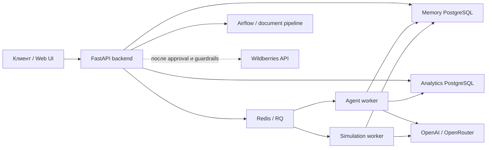

> Reference guide for the exported backend. See the root README for portfolio scope and verification limits.

# AI-KAM Backend API

Backend-сервис для AI-аналитики и управления e-commerce на данных маркетплейсов. Система принимает бизнес-вопросы на естественном языке, проверяет их профильными агентами по данным PostgreSQL и возвращает структурированные выводы, ограничения и безопасные следующие действия.

Это не просто LLM-чат: в проект входят FastAPI API, доменная маршрутизация, детерминированные расчёты, память диалога, WebSocket, очередь фоновых задач, Action Board и контур Manager Decision.

## Что решает система

AI-KAM помогает отвечать на прикладные вопросы:

- почему изменилась выручка и какие SKU дали основной вклад;
- где источник проблемы: продажи, реклама, цена, финансы или остатки;
- какие товары рискуют уйти в out-of-stock;
- безопасно ли участвовать в акции или менять цену;
- как действие повлияет на маржу и contribution profit;
- какие действия приоритетны и какими данными они подтверждены.

Backend поддерживает:

- профильных агентов продаж, финансов, маркетинга, цен и поставок;
- REST API и WebSocket-чат с историей, трассировками, раундами анализа и пробелами данных;
- фоновые agent runs через Redis/RQ;
- отдельный PostgreSQL для памяти чатов, Action Board и Manager Decision;
- поиск возможностей роста и прогноз эффекта действий;
- импорт себестоимости, анализ договоров, юнит-экономику и расчёт комиссий;
- профили моделей OpenAI и экспериментальный OpenRouter;
- Manager Decision v1: приоритизацию портфеля действий, approval flow, idempotency, guardrails, измерение результата и калибровку.
- Decision Simulation Engine для наблюдаемого bootstrap-ranking рекламных действий.

## Архитектура



`backend` принимает запросы и отдаёт состояние, `worker` выполняет долгие агентские задачи, отдельный `simulation-worker` обслуживает очередь `decision-simulations`, а `simulation-reconciler` — независимую maintenance-очередь. Redis доставляет jobs, `postgresmemory` остаётся источником истины и хранит snapshots, batch-агрегаты, ranking и replayable events. Аналитическая PostgreSQL с данными маркетплейса подключается как внешний источник данных.

Типовой диагностический workflow:

```text
Вопрос пользователя
      ↓
Определение режима и домена
      ↓
Профильный агент + смежные проверки
      ↓
Read-only аналитические tools и детерминированные отчёты
      ↓
Synthesis, critic и guardrails
      ↓
Ответ, gaps, forecast и безопасные следующие действия
```

## AI-агенты

- **Sales Agent** — заказы, продажи, выручка, SKU-декомпозиция, регионы, склады, отмены, выкупы и воронка карточки.
- **Marketing Agent** — кампании, CTR, CPC, DRR, ставки, бюджет, расход и атрибутированная выручка.
- **Finance Agent** — COGS, комиссии, логистика, хранение, штрафы, выплаты, маржа и contribution profit.
- **Supply Agent** — доступный остаток, скорость продаж, поставки, lead time, покрытие запасом и риск OOS.
- **Price Agent** — цена, скидки, unit economics, конкурентное окружение и безопасные ценовые сценарии.

Оркестратор выбирает основной домен, запускает необходимые перекрёстные проверки и сохраняет происхождение фактов. Для аналитических ответов используются ограниченные доменные tools и проверка SQL; исполняемые действия проходят отдельный lifecycle.

## Быстрый запуск через Docker

Требуются Docker Engine и Docker Compose.

```bash
git clone https://github.com/semenovjenya/ecommerce-ai-backend.git
cd ecommerce-ai-backend
cp .env.example .env
```

Минимально заполните в `.env`:

```dotenv
OPENAI_API_KEY=...
ANALYTICS_POSTGRES_HOST=...
ANALYTICS_POSTGRES_PORT=5432
ANALYTICS_POSTGRES_DB=...
ANALYTICS_POSTGRES_USER=...
ANALYTICS_POSTGRES_PASSWORD=...
```

Запустите полный runtime:

```bash
docker compose up --build
```

После старта доступны:

- API: <http://localhost:8000>
- Swagger UI: <http://localhost:8000/docs>
- ReDoc: <http://localhost:8000/redoc>
- healthcheck: <http://localhost:8000/health>

Проверка:

```bash
curl http://localhost:8000/health
```

Остановить сервисы:

```bash
docker compose down
```

Данные memory PostgreSQL сохраняются в volume `postgresmemory_data`. Команда `docker compose down -v` удалит этот volume вместе с локальной памятью.

## Локальная разработка

Основной runtime использует Python 3.11.

```bash
python3.11 -m venv .venv
source .venv/bin/activate
python -m pip install -r requirements.txt
cp .env.example .env
docker compose up -d postgresmemory redis
uvicorn agi_ecom_app.api:app --reload --host 0.0.0.0 --port 8000
```

Worker запускается в отдельном терминале из того же окружения:

```bash
python -m agi_ecom_app.worker
```

При локальном запуске используйте `MEMORY_POSTGRES_HOST=localhost` и `REDIS_URL=redis://localhost:6379/0`. В Docker Compose эти адреса автоматически заменяются именами сервисов.

## Конфигурация

Все секреты задаются через `.env`; реальный `.env` не должен попадать в Git. Безопасный шаблон находится в [`.env.example`](../.env.example).

| Группа | Основные переменные | Назначение |
|---|---|---|
| LLM | `OPENAI_API_KEY`, `OPENAI_MODEL`, `OPENAI_MEMORY_MODEL` | основной OpenAI runtime |
| Model profile | `LLM_MODEL_PROFILE`, `OPENROUTER_API_KEY`, `OPENROUTER_MODEL` | выбор провайдера и модели |
| Analytics DB | `ANALYTICS_POSTGRES_*` | внешний источник аналитики |
| Analytics pool | `POSTGRES_POOL_*` | process-local пул соединений к аналитической PostgreSQL |
| Memory DB | `MEMORY_POSTGRES_*` | чаты, agent runs, решения и измерения |
| Memory pool | `MEMORY_POSTGRES_POOL_*` | пул соединений process-local к memory PostgreSQL |
| Queue | `REDIS_URL`, `AGENT_QUEUE_NAME`, `AGENT_JOB_TIMEOUT_SECONDS` | очередь фоновых запусков |
| Workflow | `AGENT_WORKFLOW_VERSION` | `v1`, `v2_prompt` или `v2_optimized` |
| Manager | `MANAGER_DECISION_ENABLED`, `MANAGER_DAILY_*`, `MANAGER_JWT_*` | контур управленческих решений |
| Simulation | `DECISION_SIMULATION_MODE`, `DECISION_SIMULATION_PRICING_MODE`, `DECISION_SIMULATION_*` | реклама: `off/shadow/enforced`; цена v1: `off/shadow`; отдельная очередь и reconciler |
| Experiment program | `EXPERIMENT_PROGRAM_*` | durable frontier, typed negotiation journal и LISTEN/NOTIFY outbox worker без двухсекундного polling |
| WB writes | `WB_ADS_WRITE_ENABLED`, `WB_PRICE_WRITE_ENABLED`, `WB_API_SANDBOX` | независимые предохранители внешних изменений |
| Airflow | `AIRFLOW_BASE_URL`, `AIRFLOW_USERNAME`, `AIRFLOW_PASSWORD` | обработка документов |

### Профили моделей

| Профиль | Провайдер | Статус |
|---|---|---|
| `openai_default` | OpenAI Responses API | основной |
| `openrouter_gemma_free` | OpenRouter Responses-compatible API | экспериментальный |

Активный профиль задаётся через `LLM_MODEL_PROFILE` при старте или меняется через `PUT /v1/model-profile`. Переключение разрешено только на профиль, для которого настроен обязательный API key.

## API

Актуальная схема и модели доступны в Swagger UI на `/docs`.

| Группа | Маршруты |
|---|---|
| Состояние | `GET /health`, `GET/PUT /v1/model-profile` |
| Чат | `/v1/chat/sessions`, `/v1/chat/messages`, `/v1/chat/ws` |
| Agent runs | `/v1/chat/agent-runs/{run_id}`, `/status`, `/rounds`, `/gaps` |
| Аналитика | `/v1/dashboard/daily`, `/v1/forecast/growth-opportunities`, `/v1/promos/*` |
| SKU и финансы | `/v1/skus/previews`, `/v1/finance/*` |
| Action Board | `/v1/agent-actions`, `/v1/agent-actions/executions` |
| Manager | `/v1/auth/login`, `/v1/manager/decisions/*`, `/v1/manager/actions/*`, `/v1/manager/simulations/*`, `/v1/manager/experiment-programs/*` |

Создание чат-сессии:

```bash
curl -X POST http://localhost:8000/v1/chat/sessions
```

Отправка сообщения выполняется асинхронно и возвращает `202 Accepted`:

```bash
curl -X POST http://localhost:8000/v1/chat/messages \
  -H 'Content-Type: application/json' \
  -d '{"chat_id":"<CHAT_ID>","message":"Почему снизились продажи за последние 7 дней?"}'
```

Статус результата проверяется через `GET /v1/chat/agent-runs/{run_id}/status` или WebSocket `/v1/chat/ws`.

## Guardrails и Manager Decision v1

Backend отделяет аналитические выводы от исполняемых действий. В системе предусмотрены:

- доменные ограничения и read-only validation аналитического SQL;
- структурированные output-контракты и проверка обязательных доказательств;
- явные gaps при отсутствии данных вместо подстановки нулей;
- idempotency для сообщений, approval и внешних действий;
- preflight, свежие guardrails, stop conditions и read-after-write verification;
- независимые feature flags для рекламы и цен.

Manager Decision предназначен только для явных запросов на портфель действий. Он включается совместно с оптимизированным workflow:

```dotenv
AGENT_WORKFLOW_VERSION=v2_optimized
MANAGER_DECISION_ENABLED=true
MANAGER_JWT_SECRET=<long-random-secret>
MANAGER_BOOTSTRAP_ADMIN_USERNAME=admin
MANAGER_BOOTSTRAP_ADMIN_PASSWORD=<strong-password>
```

Пилот симуляции рекламных пауз включается отдельно:

```dotenv
DECISION_SIMULATION_MODE=shadow   # затем enforced после проверки
DECISION_SIMULATION_QUEUE_NAME=decision-simulations
DECISION_SIMULATION_MAINTENANCE_QUEUE_NAME=decision-simulations-maintenance
```

Для каждого из 3–7 доказанных `pause_campaign` кандидатов worker выполняет 500
NumPy bootstrap-исходов как 10 наблюдаемых batch по 50. Postgres хранит входной
snapshot, SHA-256, seeds, агрегаты и append-only events; 3 500 сырых исходов не
сохраняются. Runtime воспроизводимости фиксирует NumPy version, `PCG64` и
quantile method; версия NumPy закреплена в dependencies. `shadow` не меняет публичный ranking. В `enforced` решение остаётся
`evaluating` и не может быть approved, пока numerical ranking и LLM Critic не
завершатся. Live-прогресс доступен через SSE
`GET /v1/manager/simulations/{run_id}/events/stream` с `Last-Event-ID`.
Один PostgreSQL `LISTEN` на процесс API раздаёт уведомления всем SSE-клиентам по
`run_id`; reconnect всегда дочитывает durable event journal. Аналогично chat
WebSocket получает agent-run status через `LISTEN/NOTIFY`, без опроса Postgres
каждые две секунды. Agent worker заранее поддерживает несколько будущих
reconciliation jobs: вопрос, оставшийся `running` после SIGKILL/потери worker,
атомарно переводится в `failed`, после чего раунд идемпотентно продолжает или
завершает весь run.

Ценовая симуляция v1 включается независимо и только в shadow-режиме:

```dotenv
DECISION_SIMULATION_PRICING_MODE=shadow
```

`POST /v1/manager/pricing/simulations` принимает `nmId`, фиксированный горизонт
7 дней и опциональную сетку цен. Текущая цена всегда добавляется как hold;
всего разрешено 3–7 кандидатов и не более ±10% от неё. Каждый кандидат получает
500 NumPy bootstrap-исходов (10 batch по 50). Evidence snapshot фиксирует
завершённые price/order observations, эмпирическую эластичность, долю
реализованных продаж, payout-based unit economics, остаток и freshness.
Недостаточные, устаревшие или противоречивые evidence блокируют расчёт без
подстановки допущений. Ценовой winner сохраняется для наблюдения, но
ManagerDecision остаётся `needs_data`, experiments не создаются и WB price
write не вызывается: историческая зависимость цены и спроса пока не считается
causal-valid.

По умолчанию внешние записи отключены:

```dotenv
WB_ADS_WRITE_ENABLED=false
WB_PRICE_WRITE_ENABLED=false
WB_API_SANDBOX=true
```

Наличие WB-токена само по себе не разрешает действие. Для исполнения нужны авторизация, approval, `Idempotency-Key`, свежий preflight/guardrail snapshot и read-after-write проверка. Порядок rollout описан в [`docs/manager-decision-v1.md`](manager-decision-v1.md).

## Тесты и проверки

```bash
python -m pytest -q
docker compose config --quiet
```

Release gate Manager Decision запускается на размеченных исторических случаях:

```bash
python -m agi_ecom_app.manager_evaluation /path/to/manager-history.json
```

Код возврата `0` означает, что все критерии пройдены; отсутствие данных или нарушение порогов даёт ненулевой код.

## Структура репозитория

```text
agi_ecom_app/
  api.py                 # FastAPI application
  agent_queue.py         # постановка и оркестрация agent runs
  agent_run_notifications.py # shared LISTEN fan-out для websocket status
  worker.py              # RQ worker
  simulation_worker.py   # simulation worker/reconciler в отдельных сервисах
  decision_simulation/   # NumPy engine, critic, orchestration, metrics
  forecast/              # расчёты, прогноз, critic и synthesis
  manager_decision/      # построение Manager Decision
  manager_lifecycle/     # approval, execution, measurement, calibration
  services/              # PostgreSQL, memory и внешние интеграции
  prompts/               # системные промпты и каталоги данных
docker/postgresmemory/   # схема memory PostgreSQL
docs/                    # продуктовая и техническая документация
sql/                     # аналитические mart/view scripts
tests/                   # unit, API и regression tests
```

Дополнительные материалы:

- [`docs/project-summary.md`](project-summary.md) — продуктовое и техническое резюме;
- [`docs/agent-derived-feature-catalog.md`](agent-derived-feature-catalog.md) — каталог производных признаков;
- [`docs/langfuse-rollout.md`](langfuse-rollout.md) — включение Langfuse, dashboards, dual-export pilot и rollback;
- [`sql/agent_marts/README.md`](../sql/agent_marts/README.md) — аналитические витрины агентов.

## Runtime и сборка

Production backend запускается из исходного кода через Docker и uvicorn. Каталоги `build/` и `dist/` содержат локальные артефакты PyInstaller и не должны использоваться для деплоя: устаревший бинарник может запустить старую версию агентского кода.

Если нужен desktop-бинарник, PyInstaller необходимо запускать на целевой ОС:

```bash
pyinstaller --onefile main.py
```

Сборка на macOS создаёт macOS executable, а не Windows `.exe`.
